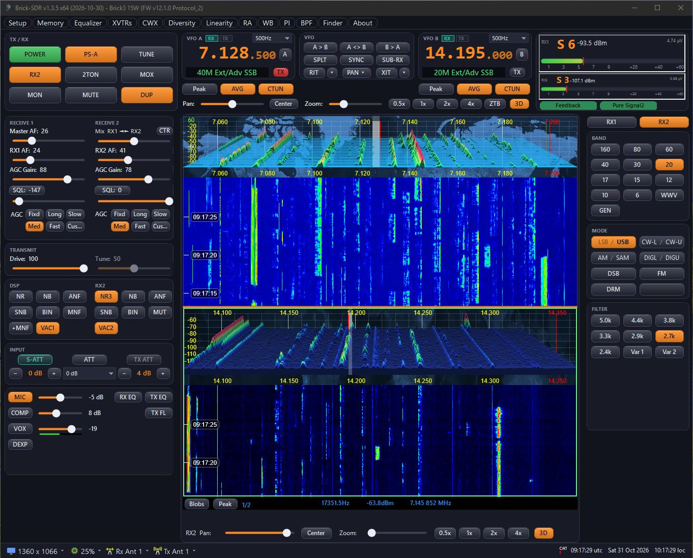
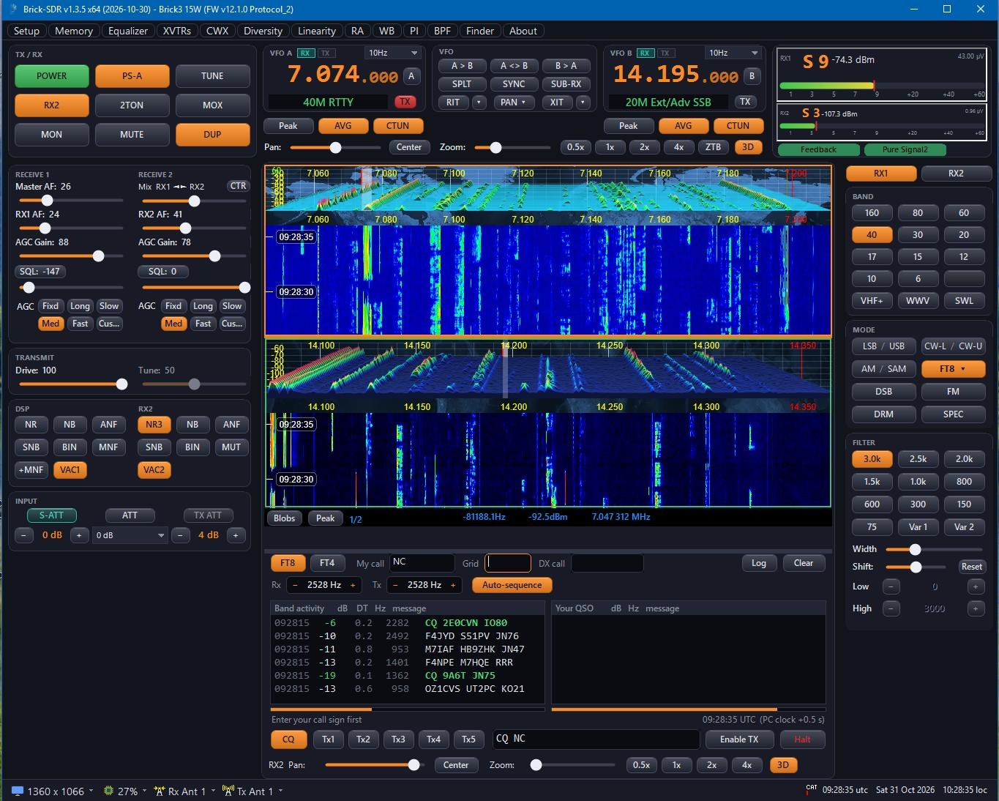
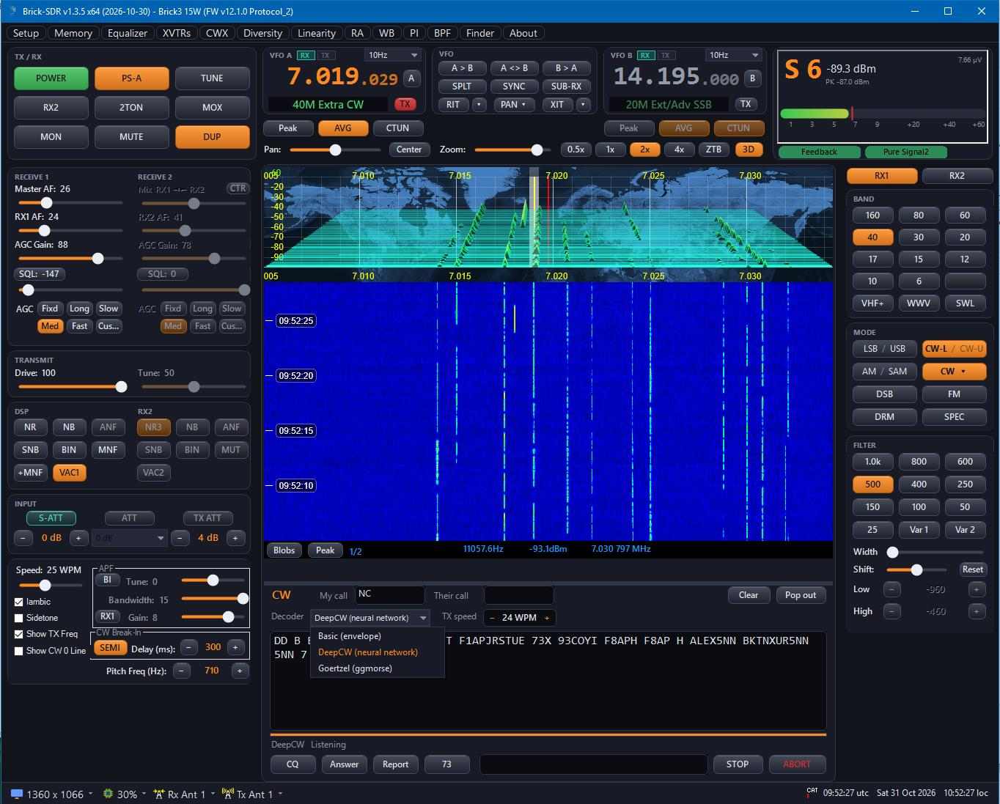
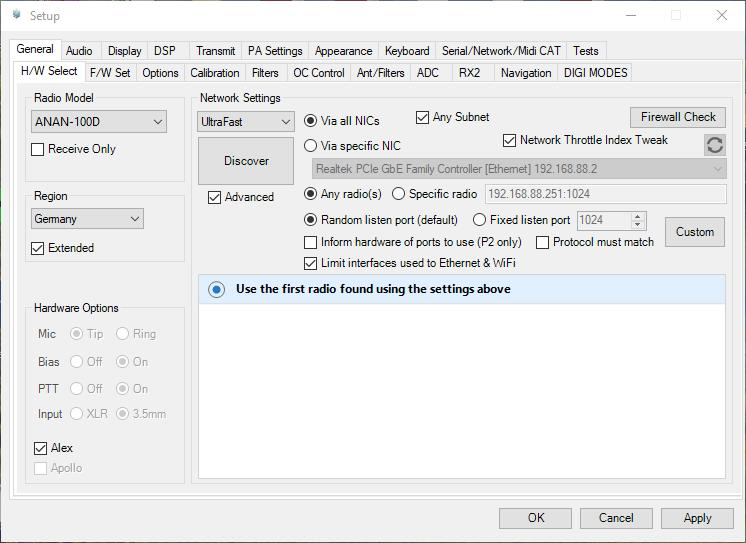
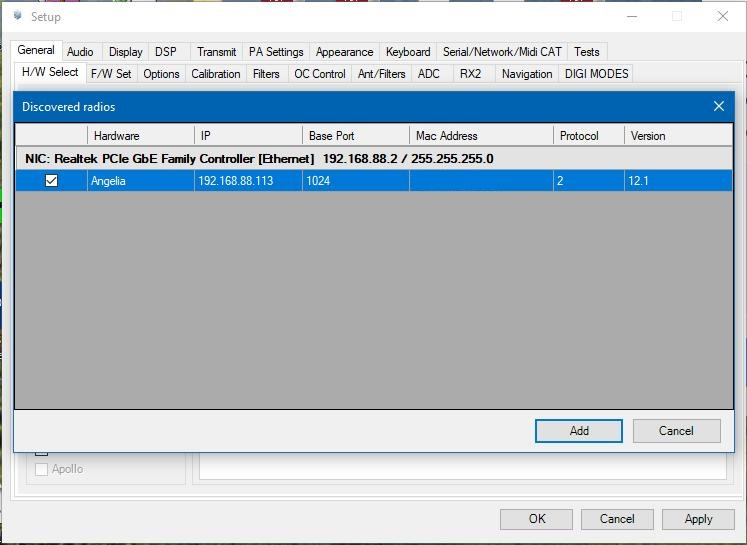
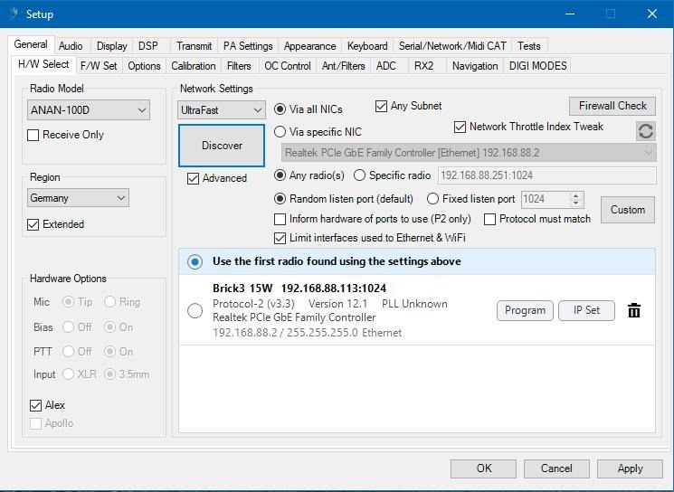

# Brick-SDR

Brick-SDR is a restyled fork of Thetis 2.10.3.x (SDR console for OpenHPSDR / ANAN radios) with a new dark interface, MAC-based Brick2/Brick3 detection, and the official WDSP 2.11 (including the new NNR noise reduction). It provides out-of-the-box support for Brick2 SDR 14-bit (15W and 50W versions), Brick2 SDR 16-bit, and Brick3 SDR dual 16-bit, as well as built-in firmware flashing and static IP address assignment.

Windows, .NET Framework 4.8, x64.

## Screenshots

### Main window with RX1 and RX2


### FT8 / FT4
Decoding and transmitting FT8 and FT4 under the panadapter (DIGI menu), with the band activity and your QSO lists.



### CW with three decoders
The CW window with the decoder switch: Basic, DeepCW (neural network) and Goertzel.



### Radio setup
Setup - General - H/W Select: discover the radio, add it to the list, then program the firmware or set the IP address.

| Radio settings | Discovered radios | Radio in the list |
|---|---|---|
|  |  |  |

## Install

Download `BrickSDR-Setup.exe` from the [Releases](../../releases) page and run it (administrator rights are needed to create the firewall rule). Windows SmartScreen may warn about an unknown publisher because the installer is not code-signed: choose *More info → Run anyway*.

## Build

```
cd "Project Files\Source"
MSBuild.exe Console\BrickSDR.csproj -p:Configuration=Release -p:Platform=x64
```

The result is written to `Project Files\bin\x64\Release`. The installer is built with `Installer\build-installer.ps1`.

## Licence

GNU GPL, see `LICENSE` and `LICENSE-DUAL-LICENSING`. Brick-SDR is based on Thetis by Richie (MW0LGE) and contributors, which is based on PowerSDR by FlexRadio Systems and contributors; WDSP is by Warren Pratt (NR0V).
