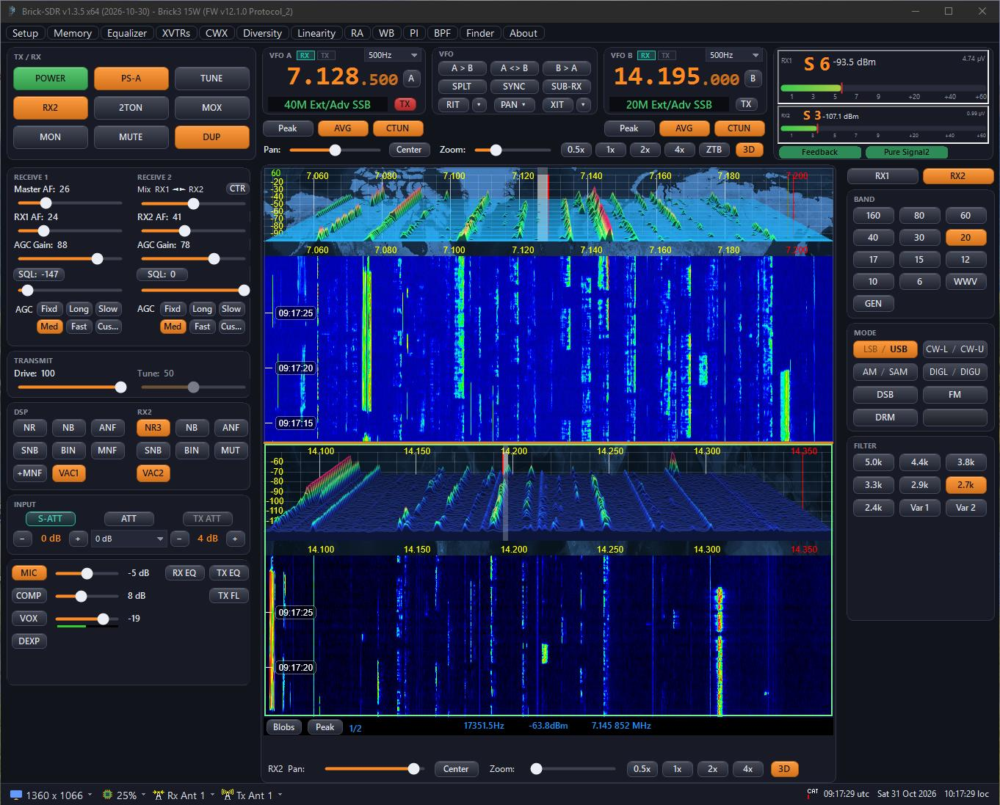
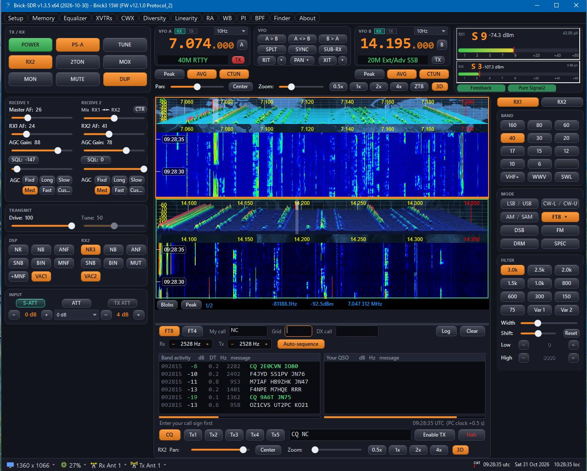
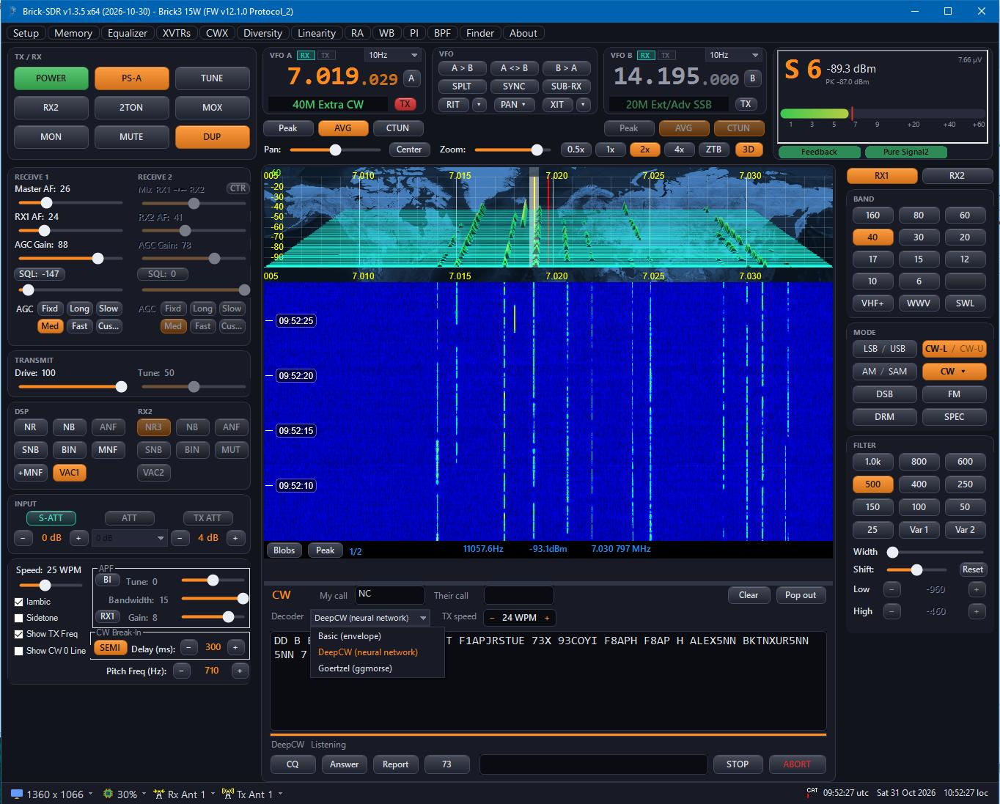
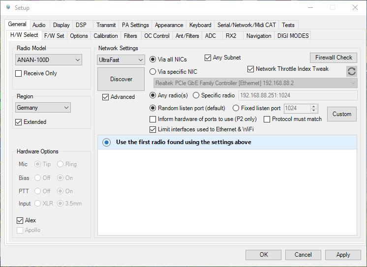
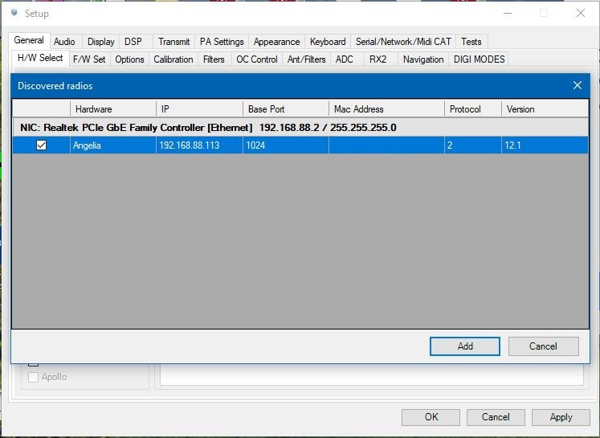
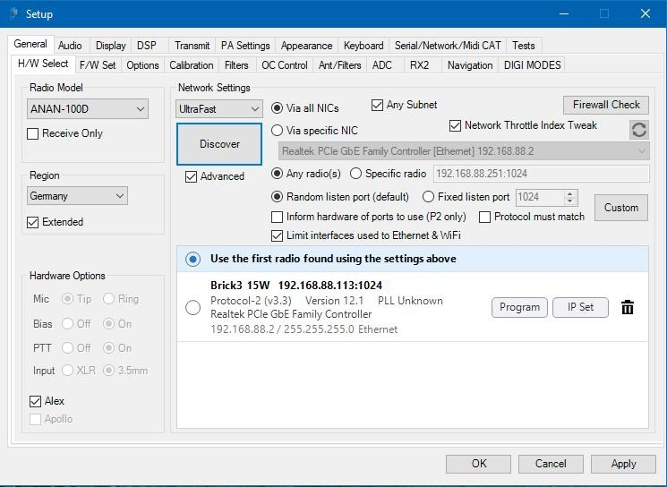

# Brick-SDR

Brick-SDR is a restyled fork of Thetis 2.10.3.x (SDR console for OpenHPSDR / ANAN /Hermes-Lite2 radios) with a new dark interface, MAC-based Brick2/Brick3 detection, and the official WDSP 2.11 (including the new NNR noise reduction). It provides out-of-the-box support for Brick2 SDR 14-bit (15W and 50W versions), Brick2 SDR 16-bit, and Brick3 SDR dual 16-bit, as well as built-in firmware flashing and static IP address assignment.

Windows, .NET Framework 4.8, x64.

## Screenshots

### Main window with RX1 and RX2


### FT8 / FT4
Decoding and transmitting FT8 and FT4 under the panadapter (DIGI menu), with the band activity and your QSO lists.



### CW with three decoders
The CW window with the decoder switch: Basic, DeepCW (neural network) and Goertzel.



### Radio setup
Setup - General - H/W Select: discover the radio, add it to the list, then program the firmware or set the IP address.

| Radio settings | Discovered radios | Radio in the list |
|---|---|---|
|  |  |  |

## Install

Brick-SDR is installed with a Windows Installer package (`.msi`). Releases are on the [Releases](../../releases) page; every release has the installer and a `VirusTotal_url.txt` with the link to the VirusTotal report of that file.

1. **If you installed an older version with the `.exe` installer (`BrickSDR-Setup_1.3.x.exe` or older), uninstall it first:** Windows Settings → Apps → Brick-SDR → Uninstall. The `.msi` does not remove it. Your settings are not lost, they live in `%APPDATA%\OpenHPSDR\Brick-SDR-x64`.
2. Download `BrickSDR-Setup_<version>.msi` and run it. Administrator rights are needed (Program Files and a Windows Firewall exception for the program, the radio answers from the network).
3. Start Brick-SDR from the Start menu or the desktop shortcut, then Setup → General → H/W Select → *Discover*.

What the installer does: copies the program to `C:\Program Files\Brick-SDR`, adds Start menu and desktop shortcuts, adds the firewall exception for `BrickSDR.exe`, and sets Windows' graphics preference of the program to the high performance GPU (for the user who installs). Later `.msi` versions update the installed one by themselves. Uninstall: Windows Settings → Apps. Silent install: `msiexec /i BrickSDR-Setup_<version>.msi /qn`.

The installer is not code-signed. Windows SmartScreen may warn about an unknown publisher (*More info → Run anyway*), and a few anti-virus engines may flag it with a generic heuristic verdict; compare the result in the VirusTotal report of the release and, if you prefer, build the program yourself (below).

**Pre-releases** (for example the Hermes Lite 2 test version) are marked *Pre-release* on the Releases page and may contain functions that have not been tested on real hardware. Please report what you find as [issues](../../issues) with the data that helps (radio and firmware, `ErrorLog.txt` from `%APPDATA%\OpenHPSDR\Brick-SDR-x64`, screenshots).

## Build

```
cd "Project Files\Source"
MSBuild.exe Console\BrickSDR.csproj -p:Configuration=Release -p:Platform=x64
```

The result is written to `Project Files\bin\x64\Release`. The `.msi` installer is built with `Installer\build-msi.ps1` (needs WiX 5: `dotnet tool install --global wix --version 5.0.2` and `wix extension add -g WixToolset.Firewall.wixext/5.0.2`); the version is taken from `BrickBranding.cs`. `Installer\build-installer.ps1` builds the older self-extracting `.exe` installer.

## Licence

GNU GPL, see `LICENSE` and `LICENSE-DUAL-LICENSING`. Brick-SDR is based on Thetis by Richie (MW0LGE) and contributors, which is based on PowerSDR by FlexRadio Systems and contributors; WDSP is by Warren Pratt (NR0V).
